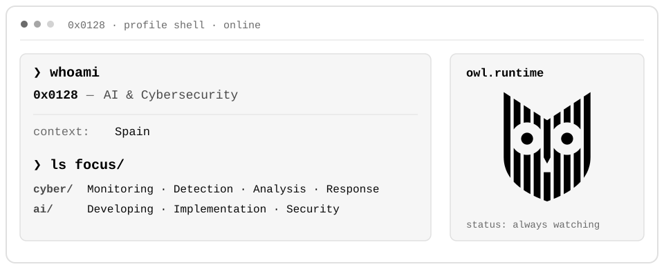
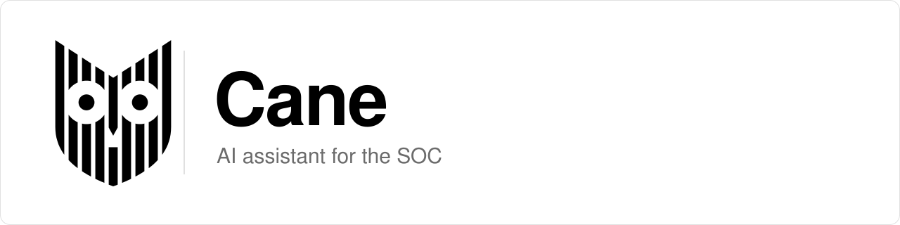
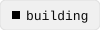
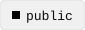
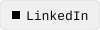
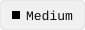
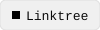

<a href="https://github.com/0x0128">
  <picture>
    <source media="(prefers-color-scheme: dark)" srcset="assets/banner-dark.svg">
    
  </picture>
</a>

---

## `$ whoami`

  <picture>
    <source media="(prefers-color-scheme: dark)" srcset="assets/whoami-dark.svg">
    
  </picture>

---

## `$ cat skills-radar.log`

  <picture>
    <source media="(prefers-color-scheme: dark)" srcset="assets/radar-dark.svg">
    
  </picture>

<code>signals: live_skill_radar · self_rated · status: evolving</code>

---

## `$ ls projects/ --featured`

<table>
  <tbody>
    <tr>
      <td width="50%" valign="top">
        <picture>
          <source media="(prefers-color-scheme: dark)" srcset="assets/cards/cane-header-dark.svg">
          
        </picture> 
        <picture>
          <source media="(prefers-color-scheme: dark)" srcset="assets/chips/status-building-dark.svg">
          
        </picture> 
        An AI assistant for the SOC.
      </td>
      <td width="50%" valign="top">
        <picture>
          <source media="(prefers-color-scheme: dark)" srcset="assets/cards/loupe-header-dark.svg">
          
        </picture> 
        <picture>
          <source media="(prefers-color-scheme: dark)" srcset="assets/chips/status-building-dark.svg">
          
        </picture> 
        A lab SOC: a home lab for writing detections and investigating what they catch.
      </td>
    </tr>
    <tr>
      <td width="50%" valign="top">
        <a href="https://github.com/0x0128/CTF-WriteUps"><picture>
          <source media="(prefers-color-scheme: dark)" srcset="assets/cards/ctf-writeups-header-dark.svg">
          
        </picture></a> 
        <picture>
          <source media="(prefers-color-scheme: dark)" srcset="assets/chips/status-public-dark.svg">
          
        </picture> 
        Write-ups of solved machines from Hack The Box, TryHackMe and VulnHub. <a href="https://github.com/0x0128/CTF-WriteUps">Open repo</a>
      </td>
      <td width="50%" valign="top">
        <a href="https://github.com/0x0128/Documentation"><picture>
          <source media="(prefers-color-scheme: dark)" srcset="assets/cards/documentation-header-dark.svg">
          
        </picture></a> 
        <picture>
          <source media="(prefers-color-scheme: dark)" srcset="assets/chips/status-public-dark.svg">
          
        </picture> 
        A cybersecurity manual: notes from courses and studies. <a href="https://github.com/0x0128/Documentation">Open repo</a>
      </td>
    </tr>
  </tbody>
</table>

---

## `$ git log --stats`

<a href="https://git.io/streak-stats">
  <picture>
    <source media="(prefers-color-scheme: dark)" srcset="https://streak-stats.demolab.com?user=0x0128&background=0A0A0A&border=2A2A2A&stroke=2A2A2A&ring=FFFFFF&fire=FFFFFF&currStreakNum=FFFFFF&sideNums=FFFFFF&currStreakLabel=FFFFFF&sideLabels=8C8C8C&dates=8C8C8C&border_radius=14&date_format=j%20M%5B%20Y%5D">
    
  </picture>
</a>

---

## `$ connect --contact`

<a href="https://www.linkedin.com/in/alaabenyahiaelharrak/"><picture><source media="(prefers-color-scheme: dark)" srcset="assets/chips/link-linkedin-dark.svg"></picture></a>&nbsp;&nbsp;
<a href="https://medium.com/@0x0128"><picture><source media="(prefers-color-scheme: dark)" srcset="assets/chips/link-medium-dark.svg"></picture></a>&nbsp;&nbsp;
<a href="https://linktr.ee/0x0128"><picture><source media="(prefers-color-scheme: dark)" srcset="assets/chips/link-linktree-dark.svg"></picture></a>

 

<code>0x0128 = 0000 0001 0010 1000</code>

